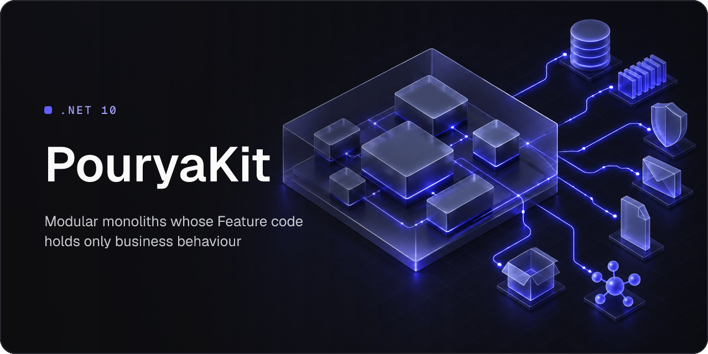

# PouryaKit

A reusable .NET 10 foundation for modular monoliths, in which Feature code holds only business behaviour. The Feature supplies the aggregate, the command or query, its validator and handler, its data access and its endpoint. The Kit dispatches the Operation, validates it, owns its single commit, runs its reactions and delivers its Integration Events and Snapshots to other Modules.

This repository publishes the Kit's AI skill, which teaches a coding agent to build on the Kit, and the cover images of the Kit and its packages. The documentation is on [the PouryaKit site](https://pouryakit.vercel.app), and the packages are on [nuget.org](https://www.nuget.org/packages?q=PouryaKit).

## Install the skill

For any agent the skills CLI installs to, Claude Code, Codex and Cursor among them, into the current project:

```sh
npx skills add PouryaNoufallah96/pouryakit-pub
```

Add `-g` to install it for your user instead, and `-a <agent>` to choose the agents.

For Claude Code, as a plugin from this repository's marketplace:

```sh
claude plugin marketplace add PouryaNoufallah96/pouryakit-pub
claude plugin install pourya-kit@pouryakit
```

Inside a Claude Code session, the same is `/plugin marketplace add PouryaNoufallah96/pouryakit-pub`, then `/plugin install pourya-kit@pouryakit`.

For Codex, as a plugin from the same marketplace:

```sh
codex plugin marketplace add PouryaNoufallah96/pouryakit-pub
codex plugin add pourya-kit@pouryakit
```

## What the skill holds

[`SKILL.md`](skills/pourya-kit/SKILL.md) states the rules that hold in every Capability of the Kit and lists each Capability with the packages that deliver it. Its `references/` folder holds a reference per Capability, which an agent reads before it writes, reviews or tests code that uses it, and the Host recipes guide.

## Licence

MIT, as the [licence](LICENSE) states.
